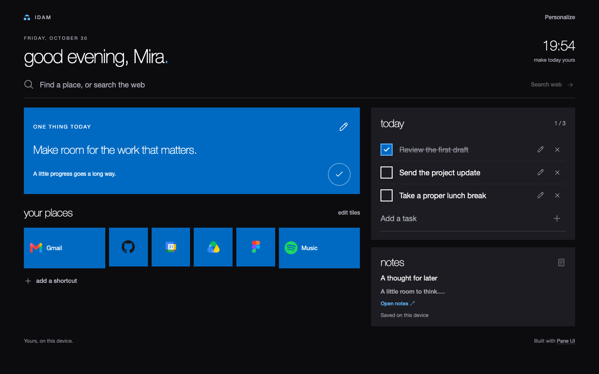

# Idam


Your space in the browser. A personal workspace with colorful tiles, built with [Pane UI](https://github.com/ajmalhassan/pane-ui), and a matching Vivaldi theme.

[Website](https://idam.ajmalhassan.com/) · [Releases](https://github.com/ajmalhassan/idam/releases) · [Privacy](docs/PRIVACY.md)

## Install

| Product | Download | Instructions |
| --- | --- | --- |
| **Idam — New Tab** | [Extension 0.6.1 beta](https://github.com/ajmalhassan/idam/releases/download/v0.6.1/idam-new-tab-0.6.1.zip) | [Chrome and Vivaldi setup](docs/INSTALL.md) |
| **Idam for Vivaldi** | [idam.css](https://github.com/ajmalhassan/idam/releases/download/v0.6.1/idam.css) | [Vertical-tab theme setup](vivaldi/README.md) |
| **Idam Icons — Flat** | [Native Vivaldi theme ZIP](https://github.com/ajmalhassan/idam/releases/download/v0.6.1/idam-icons-flat.zip) | [Icon installation](vivaldi/icons/README.md) |
| **Idam Icons — Classic** | [Native Vivaldi theme ZIP](https://github.com/ajmalhassan/idam/releases/download/v0.6.1/idam-icons-classic.zip) | [Icon installation](vivaldi/icons/README.md) |

The extension works independently of the browser theme. The icon ZIPs are imported through Vivaldi's Themes settings; the CSS is installed separately. The Chrome Web Store listing is not yet published.



## Develop

Requires Node.js with npm; Python 3 builds the Vivaldi icon packages. Extension packaging also uses `zip` and `unzip`.

```sh
cd extension
npm ci
npm run check
npm run build
python3 -m http.server 8765 --bind 127.0.0.1 --directory dist
```

Open `http://127.0.0.1:8765/newtab.html`. To create an extension ZIP, run `npm run package` from `extension/`.

From the repository root, build the browser assets:

```sh
python3 vivaldi/icons/build.py
```

Outputs go to `vivaldi/dist/`: `idam.css`, both icon ZIPs, a license, and a dark `icons.html` preview. The editable SVG sources are checked in under `vivaldi/icons/flat/` and `vivaldi/icons/classic/`.

## Repository

```text
extension/           New-tab application, tests, build tools and vendored Pane UI
vivaldi/idam.css     Browser theme, including vertical and pinned tabs
vivaldi/icons/       SVG icon sources and native-theme packager
site/                Landing page, privacy policy and current product images
docs/                Installation, privacy, design and testing documentation
```

See [contributing](CONTRIBUTING.md), [testing](docs/TESTING.md), [extension details](extension/README.md), and [Pane UI provenance](extension/vendor/README.md).

Workspace data stays in the browser profile. Automatic website-icon requests can contact saved sites and external favicon services; see [Privacy](docs/PRIVACY.md).

## License

Idam is licensed under [MIT](LICENSE), copyright 2026 Ajmal Hassan. Vendored dependencies retain their own license notices, including [Pane UI](extension/vendor/pane-ui-react/LICENSE).
